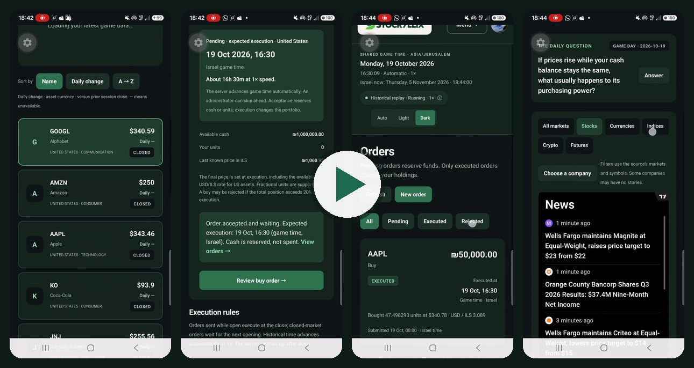
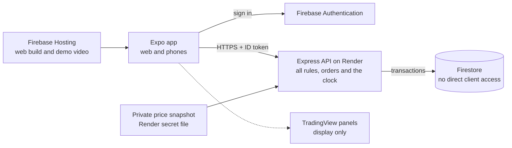

<p align="center"></p>

# Stockyllix

A weekly portfolio league: each player gets ₪1,000,000 in virtual cash, trades 20 Tel Aviv and US stocks and funds on replayed real historical prices, and is ranked every week on return and stability.

**Play in the browser: [stockyllix.web.app](https://stockyllix.web.app)** (no installation).

> To try everything, including the game clock controls, sign in with:
>
> - Email: `admin@stockyllix.com`
> - Password: `Watermelon2001@Mango!`
>
> If anything doesn't work as expected, I'd be happy to help. Thank you for your time!

## Try it in 3–5 minutes

**Or watch it first (2:49).** Recorded in Expo Go on an Android phone, not in a browser: signing in as the administrator, starting a new game, a buy blocked by the 20% rule, a ₪50,000 Apple buy that waits for the US opening, moving the game clock to execute it, and the news feed. The same video is on the app's **How to play** page.

[](https://stockyllix.web.app/demo/stockyllix-demo.mp4)

The API runs on a free server that sleeps when idle, so the first page load can take up to a minute. Moving the game clock takes from about 30 seconds to a few minutes; World controls shows the progress.

1. Open the link and sign in as the administrator. A new player can also register; every player starts with ₪1,000,000 once per game.
2. Open **Menu → World controls → Open isolated test game**, a separate copy of the game for this account. If the button says **Return to shared league**, you are already in it.
3. Choose **Start a new game → Real historical prices**, type `NEW GAME` and choose **Create new test game**. You get a fresh portfolio with ₪1,000,000.
4. Open **Demo trading → AMZN → Buy**, enter `50000`, choose **Review** and **Confirm & send order**. The order is **pending**. Portfolio shows ₪950,000 available, ₪50,000 reserved, and ₪1,000,000 total cash and total value.
5. Open **World controls → Advance to market event**. The first jump reaches the Tel Aviv opening; choose it once more to reach the US opening, where the AMZN order executes. **Orders** now shows **Executed**, the units, the dollar price and the USD/ILS rate. Portfolio shows ₪950,000 cash, ₪0 reserved and about ₪50,000 of AMZN.
6. Optional: sell ₪10,000 of AMZN and advance again, open **The league**, and answer the daily question on **News**.

## Known limits

- **The free API sleeps.** Render's free plan stops the API after 15 minutes without traffic, and the next request waits about a minute. There is no background worker either, so the clock's events are processed when requests arrive.
- **Clock jumps are slow live.** The API runs in Render's Oregon region and Firestore in Tel Aviv, so each event takes about 6 seconds, compared with well under a second locally. A jump to October 29 took about 4 minutes.
- **The reviewer login is public.** It is an administrator account, so anyone who reads this repository can also move the shared league's clock or start a new shared game. I accepted that for the review and will change the password afterwards. A real product would give reviewers a role limited to their own test game.
- **Prices are a replay.** The league replays two real weeks (October 19–November 2, 2026). Anyone can look those prices up, the league ends when the data ends, and only daily opens and closes exist, so a drop between them is not seen. Trading at live prices was not possible for free ([why](#what-i-left-out-and-why)).
- **Free quotas.** Firestore's free plan allows 50,000 reads and 20,000 writes a day. One simulated week for 1,000 players used about 136,000 reads and 32,000 writes in my load test, so thousands of players would need the paid plan ([details](#ready-for-real-users)).
- **Not verified yet:**
  - Load in the cloud with many players at once.
  - A session on a real iPhone. Android was recorded on a phone (the video above).
  - That the Firebase console's password policy matches the sign-up form code (I did 8+ characters with a letter and a number).

## What I built and why

A complete game with the operations around it: sign-up, trading under the rules, a weekly league, a shared clock, a daily return feature, CI, recovery and a runbook. Most of the effort went into the money and time rules, because those are what players have to trust.

| Assignment | How it works in Stockyllix |
| --- | --- |
| Register, buy and sell, see the table | Firebase sign-up, **Demo trading**, **Orders**, **Portfolio** and **The league** (weekly table) |
| ₪1,000,000 start, amounts in shekels, fractions | The server creates the portfolio once in a transaction. Amounts are whole agorot; units keep 18 decimals |
| Execution at close or next open, no cancellation | Each order gets a fixed execution event when it is accepted. There is no cancel endpoint |
| No shorts or leverage, 20% per asset | Buys reserve cash, sells reserve units, and the 20% limit is checked when the order is sent and again when it runs |
| US assets in dollars at the execution rate | Dollar price × the USD/ILS rate that was published before the execution event |
| Score = 0.85 × return rank + 0.15 × stability rank | Percentiles over eligible players, with MDD sampled at every price and FX event |
| 20 instruments in both markets, prices and FX over time | 10 TASE and 10 US listings (including SPY) with replayed real daily prices and Bank of Israel rates |
| One shared clock that can be advanced | A saved game clock that runs at 1× real time, with administrator jumps that process every event in between |
| One feature that brings players back | A daily finance question, with real-date return visits recorded on the server |
| Ready for real users | Server-side rules, transactions, retry-safe requests, an isolated test realm, CI and a recovery runbook ([details](#ready-for-real-users)) |

**Stack.** One Expo / React Native / TypeScript app serves the web and phones. An Express / Node API on Render (free plan) checks every Firebase ID token and runs all game rules. Firebase Authentication and Firestore stay on the free Spark plan. Firestore rules deny all direct client access, so balances, prices and time change only in API transactions.



**One buy, end to end.** After the player reviews and confirms, the app saves the request key on the device and sends it with a Firebase ID token. The API verifies the token, checks cash and the 20% limit against the latest portfolio, and saves the order and the cash reservation in one Firestore transaction. The order is fixed to its execution event, the next close or open. When the clock reaches that event, the server fills it at that event's price and USD/ILS rate and saves the portfolio with its processed-event marker in the same transaction.

**Why this shape.** Cloud Functions needs the paid Blaze plan, which needs a payment card, and the assignment asks not to add one. A small API keeps every rule in one place that the website and the phone app share and that can be tested end to end. Render's free plan has no always-on worker, so incoming requests drive the saved clock work.

## How the world was built

I replayed real history instead of generating prices or following a live feed. Real prices suit an education app, known opens and closes let the clock jump forward on demand, and a fixed snapshot makes every run repeatable. The game separates three kinds of prices, and each screen says which one it shows:

- **Real historical prices: the shared league.** 20 listings with daily open and close prices from October 19 to November 2, 2026, plus an October 16 baseline. That gives two full competition weeks and one extra day for executions. The prices come from a private Yahoo/yfinance snapshot. TASE quotes in agorot are divided by 100. USD/ILS is the Bank of Israel representative rate, and each day's rate becomes usable only at 00:00 Israel time on the next day. I chose this window because it has no reported dividends or splits, and the TASE closure on October 27 is confirmed. The snapshot is not in Git. Render loads it as a secret file, and the API never returns prices from after the current game time.
- **Simulated prices: separate test games only.** An administrator can create a 28-day game with generated prices and FX from any start date, for example March 2027, inside their isolated test realm. It exists to test dates the real data does not cover, such as the March daylight-saving changes. Prices start from fixed illustrative values and move by small random daily steps, so they are not real quotes. It is labelled "Simulated" everywhere and can never replace the shared league's data.
- **TradingView: market display only.** **Current market** and **News** embed TradingView widgets. These may be delayed and are never used to price an order.

Where each price comes from, and the data providers I checked, are in [docs/data-sources.md](docs/data-sources.md).

## The game clock and how to advance it

- Every game has one saved clock. While it runs, game time moves one second per real second from the historical date. Phones only display it; they never decide execution.
- Render's free plan sleeps, so there is no background worker. Each API request lets the server process reached events in small, saved steps. Trading pauses with a clear message until every reached event has been applied to all portfolios.
- **To advance:** sign in as an administrator and open **World controls**. You can **Pause / Resume**, **Advance to market event** (the next opening or closing; an order executes when its own scheduled event is reached), or pick a date and time in Israel time and choose **Apply time and pause**. Every jump goes forward only, stays inside the price period, and processes every event in between, in order, once.
- **Market hours in Israel time:** Tel Aviv opens at 10:00 and closes at 17:30 (13:50 on Fridays). The US opens at 16:30 and closes at 23:00, except October 26–30, when Israel has already left daylight saving time and the US has not, so the US trades 15:30–22:00. **Advance to market event** stops at every opening and closing of both markets, so reaching a US order can take more than one jump.
- **Permission:** the API allows these actions only for Firebase user IDs listed in its `ADMIN_UIDS` setting. The app hides World controls from other players, but the server is what enforces it. For this review, use the administrator account above. To give someone else access, add their Firebase user ID to `ADMIN_UIDS` on Render ([runbook](docs/runbook.md#server-configuration)).
- Administrators can also open an isolated test realm, so experiments never touch the shared league.
- A game cannot move backwards and does not loop at the end of its data. To start again, create a new game. Old games and their results stay saved.

## Rules I completed

| Rule | My decision | Why |
| --- | --- | --- |
| Starting money | ₪1,000,000 once per player per game, created in a transaction | Signing in again or a retry cannot add money |
| Order amount | A positive shekel amount with up to 2 decimals, stored as whole agorot | Exact money math with no rounding drift |
| Pending buy | The full amount is reserved. Available cash = cash − reserved | No leverage, and two pending buys cannot spend the same cash |
| Pending sell | One pending sell per asset, which reserves the units held at that time | No short selling |
| Execution time | Sent during the session: that day's close. Otherwise: the next open. Exactly at the close counts as closed | Follows the assignment and gives every order one exact event |
| 20% when sending | Current holding + pending buys + the new buy ≤ 20% of portfolio value | Parallel buys cannot get around the limit |
| 20% when executing | Checked again at the execution price, oldest order first | Prices can move before execution |
| Asset grows above 20% | No forced sale | The rule applies at the moment of buying |
| Sell after a price drop | Units are calculated at execution. The whole order is rejected if the holding no longer covers it | No negative holdings and no silent change to the amount |
| Rejected or partial orders | No partial fills. A rejection shows its reason and releases the reservation | Simple, explainable results |
| Repeated request | The same request key returns the same order. A different amount with the same key is rejected | A retry after a network timeout cannot buy twice |
| Pending orders | At most 20 per player | Keeps each update small |
| USD/ILS rate | The latest Bank of Israel rate published before the event | No rate from the future |
| Trading hours | The assignment's TA and US hours, using the Israel and New York time zones (including daylight saving). Holidays come from the data | One calendar for both markets |
| Competition week | Monday 00:00 to Saturday 00:00, Israel time | Includes Friday's US close |
| New week | Cash and holdings carry over. Start value, peak and MDD restart | No weekly cash bonus |
| Late joiners | A player who joins after Monday's 10:00 Tel Aviv opening is not ranked that week and is ranked from the next Monday | Every ranked player has the same window |
| Weekly return | End value ÷ start value − 1 | There are no deposits or withdrawals |
| MDD | The largest fall from a peak, sampled at every price and FX event | Daily high/low prices do not say which came first |
| Percentile | rank = 1 + number of players strictly better; percentile = 100 × (N − rank) ÷ (N − 1); one player gets 100; ties share | 100 means best, as the assignment defines |
| Holding only cash | Allowed: return 0% and MDD 0% | Cash is a valid choice |
| Missing price or rate | Processing stops and can resume. Nothing is invented | A wrong price is worse than a short pause |
| End of data | The clock stops. Orders with no execution event left are rejected | No looping and no made-up prices |
| Fees, dividends, splits | Not simulated. The replay window has none reported | A clear simplification |

**Rules that can be exploited, or that I would change:**

- Stability rewards holding cash: an all-cash portfolio has MDD 0% and gets the top stability percentile, worth 15 points. I'd count stability only for players who actually held assets.
- Replayed historical prices can be looked up online, so a player can trade with hindsight. A real competition needs live prices or hidden dates.
- An asset can grow above 20% after it is bought, because the rule applies only when buying.
- Anyone can sign up with any email address, so one person can run several accounts with different strategies and keep the best one. A real league would need verified accounts.

## The daily feature: a question of the day

The **News** page shows one short finance question per game day. Everyone gets the same question, the first answer is final, and the explanation teaches one concept such as drawdown, FX exposure or diversification. It does not change cash or score. The question changes at midnight in the game's Israel time.

**Why this feature:** it takes under a minute, gives a reason to open the app every day even without trading, and fits an education app. It also needs no paid data, and unlike price alerts it works without push notifications.

**How I'll know it works:** each visit to News records one review per real Israel date on the server (`reviews/{date}` and `activity/current` with `distinctRealDays` and `returnedOnLaterRealDay`). Moving the game clock does not count as a return visit. The measure is the share of players who come back on a later real day (day 1 and day 7), compared with players who never answered. That comparison only shows a correlation, because players who answer may be more engaged anyway. To show cause, I'd run an A/B test in which half of new players see the question. Nothing is proven yet, because there are no real users.

## Risks I designed for

The design starts from what must never go wrong with money and time. For each risk: what I decided, how I checked it, and what is still open.

| Risk | Decision | Evidence | Still open |
| --- | --- | --- | --- |
| Two orders spend the same cash, or pass the 20% limit together | Save the order and its reservation in one transaction. Pending buys count toward the 20% limit | With ₪100,000 available, one of two parallel ₪75,000 buys was accepted and ₪25,000 remained ([test](server/tests/trade-regression.test.ts#L80)). Two concurrent transactions in the Firestore emulator, each buying ₪150,000 of AAPL: one accepted ([emulator test](server/tests/firestore.integration.test.ts#L40)) | Checked in these cases, not under cloud load |
| A network retry buys twice | Each order carries a request key that the app saves before sending. The same key returns the same order; the same key with other details is refused | A retried ₪50,000 AMZN order returned the same order and charged nothing more ([test](server/tests/trade-regression.test.ts#L42)) | Covers retries of one request, not a second order the player sends on purpose |
| The server stops right after an order fills | Save the fill and the player's processed-event marker in one transaction. The clock job keeps a saved cursor, and a lease with a fence number so a stale worker cannot overwrite newer work | After an injected failure following a ₪50,000 fill, recovery left one executed order, ₪950,000 cash and nothing reserved ([test](server/tests/trade-regression.test.ts#L122)). A server recreated in the middle of a clock job finished it without charging twice ([test](server/tests/world-clock.test.ts#L59)), and a stale worker is fenced off ([test](server/tests/game.test.ts#L407)) | No background worker: recovery starts with the next request |
| An order uses a price or rate from the future | Reveal prices only up to the game time. A Bank of Israel rate becomes usable at 00:00 the next day | Price history stops at the game time ([test](server/tests/market-insights.test.ts#L33)), and the rate rule is tested ([test](server/tests/historical-import.test.ts#L56)) | The dates are real, so the prices can be looked up |
| A price is missing or changes under open positions | Refuse incomplete data instead of guessing. A game keeps the exact dataset it was created with | A missing market day fails the import ([test](server/tests/historical-import.test.ts#L74)), and so do wrong units and unhandled dividends or splits ([test](server/tests/yahoo-replay.test.ts#L98)) | New data means a new game |
| A clock jump must update every portfolio | Process 25 portfolios per step, at most 8 seconds per request, and save progress. Trading waits until every reached event is applied | 1,000 players over one simulated week: 1,068 steps, 135,571 reads and 32,223 writes, with balances and rankings checked ([load test](server/src/scripts/load-test.ts)) | In memory only. Live, an event takes about 6 seconds even for one player |
| Someone bypasses the app | Firestore rules deny all client access. The API verifies the ID token on every request and the admin list for clock actions | A signed-in user reading Firestore directly gets 403 ([emulator test](server/tests/firestore.integration.test.ts#L69)). Forged cash, prices and admin calls are refused ([API test](server/tests/api.test.ts#L43)) | The review login is a public administrator account |

## Ready for real users

The assignment asks what has to exist before thousands of players arrive, other developers ship every day and I go on vacation.

**Thousands of players at once (a market opening, a push).** Every rule runs on the server in Firestore transactions, so a rush cannot overspend cash or pass the 20% limit. Each player has a rate limit of 180 requests a minute. The clock job ranks the league and saves it in pages, so opening the league costs a few reads instead of a scan of all players. Clock work runs in bounded, saved steps, and while events are processed the app keeps the last data on screen with a clear message.

Where it breaks first:

1. **Free quotas.** One simulated week for 1,000 players used 135,571 reads and 32,223 writes; Spark allows 50,000 reads and 20,000 writes a day.
2. **Event processing time.** Portfolios are updated one after another, each in its own transaction, and every transaction crosses from Oregon to Tel Aviv. At a busy opening, trading would wait while thousands of portfolios are processed.
3. **One sleeping instance.** The free Render instance sleeps, and its rate limits live in that one process's memory.

What I'd change, in order: run the API next to Firestore (Cloud Run in Tel Aviv on a paid plan, or at least Render's Frankfurt region); process portfolios in parallel with a bounded pool, which stays safe because each portfolio has its own processed-event marker; move clock work to a scheduled background worker and keep request-driven catch-up as a fallback; move to paid plans; and load-test a market-opening burst in the cloud before launch.

**Other developers ship every day.** CI runs on every pull request and every push to `main`: server typecheck, lint, tests and build; app typecheck, lint, unit checks and a web export; and the Firebase Auth and Firestore emulator tests ([workflow](.github/workflows/ci.yml)). The money rules are pure functions with unit tests, and problems found in manual runs became regression tests ([trade regressions](server/tests/trade-regression.test.ts)). Render auto-deploy is off. A release goes out by hand in a fixed order: Hosting first, with the web app kept compatible with the previous API, then the API, and `/health` shows the deployed commit. A game keeps the exact dataset it was created with, so a code release cannot change prices under open positions. Still missing: a staging project and a local copy of the API (today a change is checked by the tests and then in the isolated test game), deploys from CI and automatic rollback.

**I'm on vacation.** Nothing depends on a timer, a browser tab or the server's disk. After a crash or a Render restart, the next request continues the saved clock job, and a stuck lease expires after 60 seconds. A failed step is saved on the job with its error code and shown in **World controls**, and **Advanced** offers **Resume synchronization**. Logs carry a request ID, status and duration without tokens, and every error response includes the request ID that appears in the logs. The [runbook](docs/runbook.md) maps each symptom to an action. Still missing: alerting. Nobody is notified if the API is down or the clock falls behind. I'd add an uptime check on `/health` and an alert when a due event is not processed within a few minutes.

## What I added beyond the assignment

Isolated test games for administrators, with the real history or a simulated 28-day period from any start date; asset charts and daily change sorting; a performance report (realized and unrealized profit, compared with SPY); profile name and photo; and the latest Bank of Israel reference rate. The test games let anyone with administrator access try trading and the clock in production without touching other players. The rest makes the game more useful for learning.

## What I left out, and why

- **Trading at live prices.** I looked for a free source with both markets, opening and closing history, and permission to show the data in a public app, and found none ([sources considered](docs/data-sources.md#sources-considered-for-live-or-current-data)). A live feed also cannot serve an accelerated clock: when the clock jumps to Friday's close, that close has to exist already. The game replays verified history instead.
- **Server-side live quotes and news.** Earlier versions had adapters for Yahoo quotes and Alpha Vantage news. I removed them: Yahoo requires permission for automated collection and throttled Render's requests, and the free Alpha Vantage key needs a Premium plan for news. TradingView widgets now show the real market, for display only.
- **Cancellation**, which the assignment forbids, plus partial fills, fees, dividends and splits.
- **Price alerts and push notifications.** Push to phones needs a store app or a development build, and without push an alert is only a badge inside the app. The daily question brings players back without either.
- **App-store builds, Cloud Functions and a background worker**, which need paid plans or store accounts and are not needed for the web demo.

## Repository map

| Folder | What it holds |
| --- | --- |
| [`mobile/`](mobile/README.md) | The Expo app for the web and phones: screens (`src/app`), shared components, the API client with retry-safe request keys, and Node tests for the helpers |
| [`server/`](server/README.md) | The Express API: pure game rules (`src/domain`), the game and clock services (`src/services`), sessions and datasets (`src/world`), routes and authentication (`src/api`), the Firestore and in-memory stores (`src/data`), tests and the data importers |
| [`tools/`](tools/README.md) | The one-time Python probe that downloaded the historical prices. The game never runs it |
| [`docs/`](docs/) | The [runbook](docs/runbook.md) (configuration, deployment, recovery, capacity) and [data sources](docs/data-sources.md) (where each price comes from, and the providers I checked) |
| `widgets/` | The TradingView panel page, served from a second Hosting site |
| `.github/workflows/` | CI: the server, app and Firestore emulator jobs |

At the root, `firebase.json` configures Hosting, the Firestore rules and the emulators, `firestore.rules` blocks all direct client access, and `render.yaml` describes the API service on Render.

## Run it locally

Use Node 26.13.0 and run each block from the repository root.

**On a phone with Expo Go (iOS or Android).** The app connects to the live game, so no server setup is needed. Install Expo Go on the phone (it must support Expo SDK 58), then:

```bash
cd mobile
npm ci
cp .env.example .env.local
npx expo start
```

On Windows, use `copy .env.example .env.local`. Scan the QR code with the iPhone Camera app, or from inside Expo Go on Android. The phone and the computer must be on the same Wi-Fi; otherwise run `npx expo start --tunnel`. A simulator also works: press `i` for the iOS Simulator (macOS) or `a` for an Android emulator. On a phone, Current market and News show the same TradingView panels inside the app, and their links open in the phone's browser. In a browser, use the live site: the live API does not accept requests from a local web server.

**Checks.** The server has 182 tests, plus 3 that run only against the Firebase emulators in CI (they need Java 21). The app has 49 unit checks.

```bash
cd server && npm ci && npm run typecheck && npm run lint && npm test
```

```bash
cd mobile && npm ci && npm run typecheck && npm run lint && npm test
```

The API itself runs only on Render, because it needs the private price snapshot and the Firebase service account; the tests above cover its rules without them. The emulator tests and the 1,000-player load test are in [server/README.md](server/README.md#commands). Deployment and recovery are in [docs/runbook.md](docs/runbook.md).
